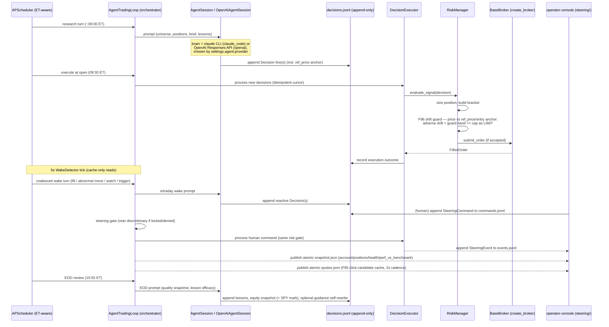

# System Architecture

## Architecture Diagram

```mermaid
graph TB
    subgraph Entry["Entry Points"]
        MAIN["main.py<br/>CLI mode dispatch + composition root"]
    end

    subgraph StrategyPath["Strategy Path (offline research / classic engine)"]
        TE["src/trading/<br/>TradingEngine (batch/realtime)"]
        BT["src/backtest/<br/>BacktestEngine + metrics + optimizer"]
        STRAT["src/strategy/<br/>technical / ensemble / LLM / ML + registry"]
        BENCH["src/benchmark/<br/>F70 shadow baselines vs live LLM account"]
    end

    subgraph AgentPath["Agent Path (LLM Portfolio Manager)"]
        ORCH["src/agent/orchestrator.py<br/>daily turn sequencing"]
        SESSION["src/agent/session.py<br/>AgentSession — headless claude -p"]
        OSESSION["src/agent/openai_session.py<br/>OpenAIAgentSession — Responses API brain"]
        JOURNAL["src/agent/journal.py<br/>decisions.jsonl / theses / lessons"]
        EXEC["src/agent/executor.py<br/>DecisionExecutor (idempotent cursor)"]
        INTRADAY["src/agent/intraday/<br/>WakeDetector (5s tick, cache-only)"]
        TRIGGERS["src/agent/triggers/<br/>F88 self-authored predicates (sandboxed)"]
        STEERING["src/agent/steering/<br/>human command channel + gate + quotes"]
        LEARNING["src/agent/learning/ + quality/<br/>lesson efficacy, recall, self-rewrite"]
        PERF["src/agent/logs/performance.py<br/>F97 agent vs SPY buy-and-hold"]
    end

    subgraph Shared["Shared Core Layers"]
        RISK["src/risk/<br/>RiskManager — the single order gate"]
        SIGNALS["src/signals/<br/>movers/earnings/IPO/sentiment/holdings brief"]
        DATA["src/data/<br/>BaseDataProvider"]
        CORE["src/core/<br/>Pydantic models, enums, JSONL/atomic-write primitives"]
    end

    subgraph Exec["Execution Layer"]
        FACTORY["execution/brokers/factory.py<br/>create_broker (provider SSOT, F92)"]
        ALPACA["AlpacaBroker<br/>Trading API (paper/live)"]
        FARM["AccountFarmBroker<br/>Broker API sub-account isolation"]
        KIS["KisBroker<br/>Korean REST"]
        SIM["SimulatedBroker<br/>backtest / evals"]
    end

    subgraph Evals["src/evals/ — LLM behavior + research-mode harness"]
        EVRUN["runner.py + grading.py<br/>scenario replay through real executor/RiskManager"]
        CMPRES["compare_research.py<br/>single/sequential/parallel research A-B"]
        RETEVAL["returns.py<br/>post-decision outcome-path scoring"]
    end

    subgraph Console["operator-console/ (TypeScript, opencode fork)"]
        TUI["TUI + MCP tools<br/>steer / steer_read / place_stock_order"]
        SYMPANEL["SymbolOverlay + use-quote hook<br/>F95 click-to-quote floating panel"]
        LAUNCHER["launcher/<br/>preflight, daemon health, systemd"]
        MOBILE["mobile serve + WebAuthn<br/>F71/F75/F93"]
        ACCTRUTH["account-truth.ts<br/>provider-aware reads (F94)"]
    end

    subgraph FileDrop["steering/ file-drop channel"]
        CMDS["commands.jsonl"]
        EVENTS["events.jsonl"]
        SNAPSHOT["snapshot.json (atomic)"]
        QUOTES["quotes.json (F95, atomic)"]
    end

    MAIN --> TE
    MAIN -->|agent.provider=claude_code| SESSION
    MAIN -->|agent.provider=openai| OSESSION
    SESSION --> ORCH
    OSESSION --> ORCH
    TE --> STRAT
    TE --> BT
    STRAT --> RISK
    BT --> RISK
    BENCH --> FACTORY

    ORCH --> JOURNAL
    JOURNAL --> EXEC
    EXEC --> RISK
    INTRADAY --> ORCH
    TRIGGERS --> INTRADAY
    STEERING --> EXEC
    LEARNING --> ORCH
    STEERING --> PERF

    RISK --> FACTORY
    SIGNALS --> DATA
    FACTORY --> ALPACA
    FACTORY --> FARM
    FACTORY --> KIS
    FACTORY --> SIM

    EVRUN --> EXEC
    EVRUN --> RISK
    EVRUN --> SIM
    CMPRES --> SESSION
    CMPRES --> OSESSION
    RETEVAL --> EXEC
    RETEVAL --> SIM

    TUI --> CMDS
    EVENTS --> TUI
    SNAPSHOT --> TUI
    QUOTES --> SYMPANEL
    STEERING --> EVENTS
    STEERING --> SNAPSHOT
    STEERING --> QUOTES
    CMDS --> STEERING
    ACCTRUTH --> SNAPSHOT
    ACCTRUTH --> ALPACA
    LAUNCHER --> MAIN
    MOBILE --> TUI

    RISK -.depends on.-> CORE
    DATA -.depends on.-> CORE
    ALPACA -.depends on.-> CORE
```

## Component Descriptions

### `src/core/`
- **Purpose**: Foundational domain layer — Pydantic models (Order, Position, PortfolioState,
  TradeSignal, FilledOrder, OpenOrder, BacktestResult), enums (Signal, OrderSide, OrderType,
  OrderClass, TimeFrame, PositionSide), exception hierarchy, market-time (ET) helpers, and
  cross-process JSONL/atomic-write primitives.
- **Responsibilities**: Provide the shared vocabulary every other layer builds on; guarantee
  torn-read-safe reads and atomic writes for append-only/rewritable state files.
- **Dependencies**: None (leaf of the dependency graph).
- **Type**: Model.

### `src/risk/`
- **Purpose**: The single order-validation gate. Converts strategy/agent/human signals into
  broker-ready `Order`s (with bracket legs) or rejects them.
- **Responsibilities**: Position sizing (now NaN/Inf-hardened and validates
  `stop_loss_pct`/`confidence` ranges), bracket-order construction (stop/target geometry, long
  and short), an **entry-drift guard (F96)** that downgrades a momentum MARKET entry to a
  LIMIT capped at `anchor ± entry_drift_guard_atr * ATR` when price has run adverse of the
  decision anchor (`signal.metadata["ref_price"]` or the LLM's `entry`) between research and
  execution — bounding worst-case fill rather than chasing, circuit breaker (market-halt
  threshold), shorting master switch + squeeze guard, human-order structured gate (F9), polled
  stop/take-profit backups.
- **Dependencies**: `src/core/`.
- **Type**: Application.

### `src/execution/`
- **Purpose**: Broker abstraction and adapters.
- **Responsibilities**: `BaseBroker` ABC defines the contract (submit_order, positions,
  portfolio state, cancel/close, fills feed, latest prices). `factory.create_broker(settings)`
  (F92) is the single composition root mapping `broker.provider` (alpaca | kis |
  account_farm) to a concrete broker — every account-truth read path must call it.
- **Dependencies**: `src/core/`.
- **Type**: Application.

### `src/data/`
- **Purpose**: Market-data abstraction over multiple sources.
- **Responsibilities**: `BaseDataProvider` interface; Alpaca (primary, with F14 HTTP
  timeouts), yfinance (fallback, public), KIS (Korean equities), and a news provider with
  keyword-based sentiment scoring. Concurrent price fetch via bounded thread pool
  (`prices.py:fetch_latest_prices`, reused by the F95 quote cache so quotes reflect
  account-independent market facts, not a broker's marking price).
- **Dependencies**: `src/core/`.
- **Type**: Application.

### `src/signals/`
- **Purpose**: Assembles the research-turn "market signal brief" fed to the LLM prompt.
- **Responsibilities**: Price movers, sector/peer read-through, Finnhub earnings & IPO
  calendars, StockTwits retail-sentiment z-outliers, disclosed 13F holdings, and a
  **news-freshness / priced-in check (F96)** that flags stale catalysts so the agent doesn't
  treat already-priced-in news as a fresh edge. Fail-honest: every source is best-effort;
  failures degrade gracefully into a `degraded_sources` list rather than aborting the brief.
- **Dependencies**: `src/data/`, `src/core/`.
- **Type**: Application.

### `src/strategy/`
- **Purpose**: Pluggable, registry-based signal generation for the classic (non-agent) path.
- **Responsibilities**: Technical indicators (RSI, MA crossover, MACD, Bollinger), weighted
  ensemble voting, LLM-powered strategy (Claude/OpenAI/claude_code providers), ML strategies.
  The LLM client layer (`llm/client.py`) now targets the modern reasoning APIs — Claude's
  `thinking: adaptive` + `output_config.effort` for `claude-{sonnet,opus,haiku,fable}-5*`
  models (temperature-based fallback for older models), and OpenAI's Responses API
  (`client.responses.create`, `reasoning.effort`) for `gpt-5*/6*`/`o1-o4` reasoning models —
  with `last_usage` capture and fail-closed validation (`ValueError` on an incomplete
  `stop_reason`/`status`, not swallowed by the retry loop).
- **Dependencies**: `src/core/`, `src/data/` (indirectly via bars).
- **Type**: Application.

### `src/agent/`
- **Purpose**: The LLM portfolio-manager brain and its deterministic body.
- **Responsibilities**: Daily turn orchestration (research/intraday/EOD), a **provider-switchable
  brain session** — `AgentSession` (headless local `claude -p` CLI) or `OpenAIAgentSession`
  (`src/agent/openai_session.py`, OpenAI Responses API with journal/market-data function tools,
  no shell or broker tool, independent of Codex subscription auth) selected by
  `settings.agent.provider`, both sharing the same prompts/journal/executor — append-only
  journal (decisions, theses, lessons, equity, turns), idempotent `DecisionExecutor`, intraday
  event-driven wake detection (5s scheduler tick, cache-only reads), self-authored long-horizon
  triggers (sandboxed predicate evaluation), human steering channel + approval gate + quote
  warm-cache (F95), self-learning (lesson efficacy, situational recall, bounded self-rewrite of
  guidance prompts), aggressiveness knob (risk/prompt/learning overlay), and a read-time
  **agent-vs-SPY performance scorecard** (`logs/performance.py`, F97 — cumulative return/alpha
  joined from the existing equity log, no new persistence).
- **Dependencies**: `src/risk/`, `src/execution/`, `src/data/`, `src/signals/`, `src/core/`.
- **Type**: Application.

### `src/trading/`
- **Purpose**: Orchestrates Data → Strategy → Risk → Broker for the classic strategy path, and
  hosts the agent trading mode's market-aware scheduler.
- **Responsibilities**: Batch/realtime cycle execution, universe-based symbol selection,
  polled risk-exit checks, agent-mode scheduling (pre-market research, open execution,
  intraday turns, EOD review, plus a 2s `refresh_quotes` job feeding the F95 click-candidate
  cache).
- **Dependencies**: `src/strategy/`, `src/risk/`, `src/execution/`, `src/data/`, `src/agent/`.
- **Type**: Application.

### `src/backtest/`
- **Purpose**: Vectorised, look-ahead-safe historical simulation.
- **Responsibilities**: Bar-by-bar engine with intra-bar protective-order triggering (gap-safe,
  matches live bracket behavior), FIFO round-trip matching for metrics, fast-path
  precompute optimization, parallel grid-search parameter optimizer.
- **Dependencies**: `src/strategy/`, `src/risk/`, `src/core/`.
- **Type**: Application.

### `src/benchmark/`
- **Purpose**: F70 shadow baselines — runs deterministic strategies on isolated sandbox
  accounts to produce an apples-to-apples comparison against the live LLM account's equity
  curve.
- **Responsibilities**: Background thread ticking independent `TradingEngine`s per baseline,
  masked-account equity snapshots, pure comparative metrics (alpha = LLM return − baseline
  return) computed over a shared overlapping window. (Distinct from the F97 agent-vs-SPY
  scorecard in `src/agent/logs/performance.py`, which compares against a passive index rather
  than a sandboxed strategy account.)
- **Dependencies**: `src/trading/`, `src/execution/` (AccountFarmBroker sandbox), `src/core/`.
- **Type**: Application.

### `src/monitoring/`
- **Purpose**: Operational health checks and alerting.
- **Responsibilities**: Dimension checkers (broker connectivity, risk compliance, account
  health, logs, data pipeline, process/resources, LLM) run in parallel via a dispatcher; one
  checker's failure never sinks the overall report. The LLM and config/env checkers are now
  **dual-provider aware** — they union `settings.llm.provider` (classic strategy path) with
  `settings.agent.provider` (agent brain) and validate both, including both `agent.model` and
  `agent.research_model`. The LLM check validates **model access only**
  (`client.models.retrieve(...)` / `client.messages.create` replaced), not a paid generation —
  so a green check proves auth + model entitlement, not that a model can complete a full
  trading turn.
- **Dependencies**: `src/execution/`, `src/risk/`, `src/core/`.
- **Type**: Application.

### `src/early_session/`
- **Purpose**: Detects and archives sharp early-session (09:30–10:30 ET) price moves for
  later agent analysis.
- **Responsibilities**: 1-minute circular buffer per symbol, pure threshold detector,
  before/after window dump to workspace.
- **Dependencies**: `src/data/`, `src/core/`.
- **Type**: Application.

### `src/surge/`
- **Purpose**: EOD surge/dive detection across the universe with agent-assisted root-cause
  tagging.
- **Responsibilities**: Daily scan sorted by magnitude, volume-ratio computation, persisted
  history + analysis JSONL.
- **Dependencies**: `src/data/`, `src/core/`.
- **Type**: Application.

### `src/universe/`
- **Purpose**: Builds and caches the tradeable symbol pool.
- **Responsibilities**: US (S&P 100 via Wikipedia, optional market-cap ranking) and KR (KIS
  ranking) base providers, theme overlays, 1-day-TTL atomic snapshot cache with fail-closed
  fallback to the last good snapshot.
- **Dependencies**: `src/core/`.
- **Type**: Application.

### `src/evals/` + `evals/`
- **Purpose**: LLM behavior evaluation and research-mode comparison harness.
- **Responsibilities**: Frozen `Scenario` fixtures (intraday/wake/EOD), sandboxed agent-turn
  execution, tier-1 deterministic grading — extraction integrity, behavior-vs-expectation,
  and **executor replay through the real production `DecisionExecutor`/`RiskManager`** (so
  grading rules can't drift from production behavior). promptfoo integration drives the test
  matrix across guidance versions and models. Two newer harnesses extend this:
  `compare_research.py` runs paired local A/B comparisons of the production research modes
  (single-pass / sequential-review / parallel-analysts) across model/effort/prompt
  `ResearchProfile`s on identical frozen cases, pinning historical prompt code via
  `profiles.py:prompt_snapshot` (git-ref or bundled baseline) without checking out old risk
  code; `returns.py` scores a single decision's **post-decision outcome path** (synthetic or
  historical future bars, replayed through a friction-aware `SimulatedBroker` subclass) to
  separate directional-call quality from execution/accounting — explicitly not a continuous
  strategy backtest or profit estimate. Results land in gitignored
  `research-comparisons/<experiment>/`.
- **Dependencies**: `src/agent/`, `src/risk/`, `src/execution/` (SimulatedBroker).
- **Type**: Test.

### `operator-console/`
- **Purpose**: Human-in-the-loop steering TUI (hard fork of `sst/opencode`, MIT-licensed, under
  `operator-console/cli/`).
- **Responsibilities**: Natural-language command parsing (deterministic, fail-closed) with
  MCP-tool auto-gating for confirmation, structured Alpaca-shaped order tools, read-only
  monitoring (status/positions/orders/thesis/screening/agent-trace), a **click-to-quote symbol
  floating panel (F95)** — `SymbolOverlay` + `use-quote` hook reads `steering/quotes.json` for
  an instant live price on click (the TUI has no request channel to the daemon, so the daemon
  keeps a warm cache of likely-clicked symbols instead), a launcher that installs/health-checks
  a systemd `--user` daemon, and a mobile path (Tailscale-only `serve` + WebAuthn passkey gate
  for remote mutating commands, PWA dashboard).
- **Dependencies**: Talks to the Python daemon exclusively via the `steering/` file-drop
  channel; never imports Python code directly.
- **Type**: Client.

## Data Flow

## Design Patterns

### Brain / Body Split
- **Location**: `src/agent/session.py` / `src/agent/openai_session.py` (brain, LLM — either
  provider) vs. `src/agent/executor.py` (body, deterministic).
- **Purpose**: The LLM can reason freely but cannot place an order; only the Python executor
  is an actuator, and it validates every action against `RiskManager` before touching a
  broker. Swapping the brain's provider (Claude CLI vs. OpenAI Responses API) changes nothing
  about this invariant — both sessions expose the same journal/tool surface and hand off to
  the identical executor.

### Single Order Gate
- **Location**: `src/risk/manager.py` (`RiskManager`), invoked from `executor.py`,
  `trading/engine.py`, `src/evals/` scenario replay, and the console's structured order tools
  (via the daemon).
- **Purpose**: No code path places an order without passing through the gate — sizing,
  bracket geometry, the entry-drift guard, circuit breaker, and shorting checks are
  centralized once. The evals harness (`src/evals/grading.py`, `returns.py`) replays through
  this *same* gate rather than re-implementing it, so test grading can't drift from production
  behavior.

### Provider Factory (Composition Root)
- **Location**: `src/execution/brokers/factory.py` (`create_broker`), `main.py`
  (`create_data_provider`, `create_strategies`, and the F-current agent-brain branch choosing
  `AgentSession` vs `OpenAIAgentSession` off `settings.agent.provider`).
- **Purpose**: Single place mapping config (`broker.provider`, `data.provider`, `llm.provider`,
  `agent.provider`) to concrete implementations; prevents hard-coded construction from silently
  reading the wrong account or running the wrong model stack (the class of bug fixed by
  F92/F94, now extended to the agent brain itself).

### Torn-Read-Safe Append + Atomic Rewrite
- **Location**: `src/core/jsonl.py` (`read_complete_lines`, `atomic_write_text`,
  `ByteCursor`); mirrored in `operator-console/src/filedrop.ts`.
- **Purpose**: Cross-process JSONL files (decisions, commands, watch, lessons) are read only
  up to the last complete line; files that must be rewritten in place (position theses,
  snapshot.json, quotes.json, executor cursor state) go through temp-file + `os.replace` so no
  reader ever observes a torn write.

### File-Drop IPC (no shared process, no network required)
- **Location**: `src/agent/steering/channel.py` ↔ `operator-console/src/filedrop.ts`.
- **Purpose**: The TypeScript console and Python daemon never call each other directly;
  they communicate purely through files in `steering/` (commands.jsonl, events.jsonl,
  snapshot.json, quotes.json), so either side can restart independently without losing state.
  The F95 quote cache extends this pattern for a read that the file-only TUI could not
  otherwise make on demand: the daemon polls candidates proactively and publishes, the TUI
  only ever reads.

### Fail-Honest / Fail-Closed Split
- **Location**: `src/signals/collector.py` (fail-honest: degrade with a visible marker,
  including the F96 news-freshness/priced-in annotation) vs. `src/risk/manager.py`
  shorting/stop/drift-guard checks, `src/risk/position_sizer.py` (NaN/Inf and range
  validation), and `src/universe/base.py` (fail-closed: refuse rather than proceed on
  missing/invalid data).
- **Purpose**: Research-quality inputs degrade gracefully (better to trade on a partial
  brief than none); safety-critical decisions (order placement, position sizing, universe
  selection) refuse outright rather than guess.

### Read-Time Derivation Over Durable Logs
- **Location**: `src/agent/logs/performance.py` (`compute_performance` / `load_performance`,
  F97) and `src/agent/steering/quotes.py` (`quote_candidates`, F95).
- **Purpose**: New operator-facing metrics (agent-vs-SPY alpha, click-candidate quote set) are
  derived by joining/filtering *existing* append-only logs (`equity.jsonl`, decisions, recent
  interventions) rather than adding new persistence or touching the EOD/execution pipeline —
  keeping the durable-state surface small and these features strictly additive and
  side-effect-free (`None` on missing/short data, never raising into the snapshot publisher).

### Model/Effort as an Explicit, Logged Axis
- **Location**: `src/strategy/llm/client.py` (`reasoning_effort`, `last_usage`),
  `src/evals/profiles.py` (`ResearchProfile`: provider/model/effort/prompt_ref), `config/config.py`
  (`AgentSettings._matching_provider` cross-validates `agent.provider` against
  `agent.model`/`agent.research_model`).
- **Purpose**: Model and reasoning-effort selection is config/profile-driven and validated at
  settings-load time (an OpenAI model under `provider=claude_code` is a hard config error, not
  a runtime surprise), and every turn/eval run records the requested effort and resolved model
  ID — so research-mode comparisons and production turns stay attributable and reproducible
  across the modernized Claude (`thinking: adaptive`) and OpenAI (Responses API `reasoning.effort`)
  reasoning-model APIs.
